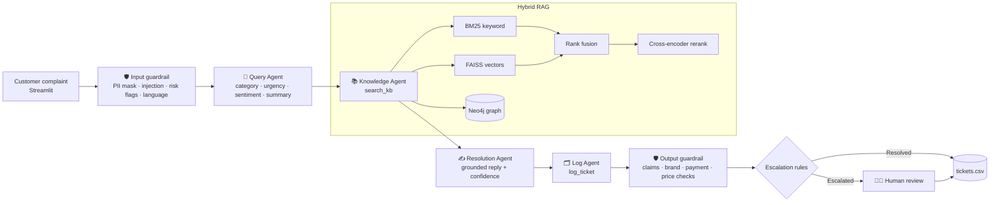

# 🌿 Maa Wellness — AI Customer Support Desk

A multi-agent support desk built with **AutoGen**, **Python** and **Streamlit**. Four AI agents read a customer complaint, find the answer in the company's own documents, write a grounded reply, and log every ticket. Hard cases are escalated to a human.

Built for **Maa Wellness** (www.maawellness.in), an Ayurvedic wellness brand. Beyond the assignment brief, it adds **guardrails**, **hybrid RAG** (FAISS vector search + BM25 keyword search + cross-encoder reranking), a **Neo4j knowledge graph**, **LangSmith tracing**, and **Docker** deployment.

## Architecture



All four agents are AutoGen `AssistantAgent`s run in order by a `RoundRobinGroupChat`. The team stops when the Log Agent says `LOGGED` (`TextMentionTermination`), with `MaxMessageTermination(12)` as a safety net.

| Agent | Single job | Tool | Output |
|---|---|---|---|
| Customer Query Agent | Understand the complaint | `record_triage` | Category, urgency (Low/Medium/High), sentiment, one-line summary, search keywords |
| Knowledge Base Agent | Find the facts | `search_kb` | Matching passages with **source file names** and knowledge-graph facts |
| Resolution Agent | Write the reply | `submit_reply` | Customer-ready reply that uses **only** retrieved facts, plus a confidence level |
| Log Agent | Record and escalate | `log_ticket` | One CSV row, plus a Resolved or Escalated decision with the reason |

Each agent ends by calling its tool, so the hand-off between agents is structured data instead of free text.

## Hybrid RAG

| Stage | Tool | Why it's there |
|---|---|---|
| Chunking | One chunk per `##` question in each `knowledge_base/*.md` file | Each chunk answers one customer question |
| Keyword search | BM25 (`rank-bm25`) | Exact terms such as "COD", "₹300", "IFSC", product names |
| Vector search | **FAISS** + `BAAI/bge-small-en-v1.5` (fastembed / ONNX) | Paraphrases, e.g. "parcel hasn't come" finds "order is late" |
| Fusion | Reciprocal Rank Fusion | Combines both rankings without tuning weights |
| Reranking | Cross-encoder `ms-marco-MiniLM-L-6-v2` | Precise final ordering. Below a score threshold the result is **"no match"**, which triggers escalation |
| Knowledge graph | **Neo4j** | Relationship questions: "which pack lasts 3 months?", "what's free with 8 tins?", "what helps with PCOD?" |

The FAISS index is rebuilt automatically when any knowledge-base file changes. If Neo4j is unavailable, the graph falls back to the same seed file in memory, so the app keeps working.

**Graph model:** `(Brand)-[:SELLS]->(Product)-[:SOLD_AS]->(Package)-[:INCLUDES_FREE]->(Product)`, `(Product)-[:SUPPORTS]->(Concern)`, `(Product)-[:CONTAINS]->(Ingredient)`, `(Brand)-[:ACCEPTS]->(PaymentMethod)`, `(Brand)-[:HAS_POLICY]->(Policy)`, and `-[:DOCUMENTED_IN]->(Document)` for sources.

## Guardrails

**Input (before any LLM call)**
- PII masking: card numbers, CVV, Aadhaar, OTPs and passwords are redacted, and only the masked text is stored
- Prompt-injection detection. The complaint is also wrapped in markers and treated as data
- Risk flags: legal threat, payment dispute, fraud, medical question, side effect, abuse, self-harm, bulk/media
- Language detection, including Tamil script, so the reply matches the customer's language

**Output (before a reply is logged or shown)**
- Removes medical claims ("cure", "guaranteed", "Viagra", "no side effects"…)
- Removes any brand or website name other than Maa Wellness / www.maawellness.in
- **Blocks** the whole reply if it contains a UPI ID, account number, IFSC or phone number that isn't official
- Flags any ₹ amount that isn't in the official rate card

## Escalation rules

Rules are enforced in code (`guardrails/escalation.py`), so a ticket can't skip a rule because the model forgot it. The Log Agent's own judgement can add an escalation but never remove one.

| Rule | Trigger |
|---|---|
| E1 | Urgency High |
| E2 | Very angry customer |
| E3 | No matching document |
| E4 | Legal threat |
| E5 | Fraud or payment dispute |
| E6 | Low confidence |
| E7 / E8 | Side effect reported / personal medical question |
| E9 | Refund for an opened product, or "didn't work" |
| E10 | High-value order (₹9,900+) with any other trigger |
| E11 | Paid on an unofficial website |
| E12 | Bulk, distributor or media enquiry |
| E13 | Repeat complaint for the same order |
| Guardrail | Reply blocked, unverified price, or prompt injection |

## Tracing (LangSmith)

Set `LANGSMITH_TRACING=true` and `LANGSMITH_API_KEY` in `.env`. Each ticket appears as one trace, `support_ticket`, containing the input guardrail, every LLM call, each tool, the retrieval steps (`bm25_search`, `faiss_search`, `rerank`, `knowledge_graph`), the output guardrail and the escalation rules.

## Setup

```bash
git clone <this-repo> && cd customer-support-agents
python3.12 -m venv .venv && source .venv/bin/activate
pip install -r requirements.txt
cp .env.example .env        # add OPENAI_API_KEY (and optional LangSmith / Neo4j settings)
```

Optional: start Neo4j for the knowledge graph. Without it, the in-memory fallback is used.

```bash
docker run -d --name neo4j -p 7474:7474 -p 7687:7687 -e NEO4J_AUTH=neo4j/<password> neo4j:5.26-community
python -m scripts.load_graph
```

Run the app:

```bash
streamlit run app.py
```

## Run with Docker

```bash
cp .env.example .env   # set OPENAI_API_KEY and NEO4J_PASSWORD
docker compose up -d --build
```

Open http://localhost:8501. Compose starts the app and Neo4j; the graph is loaded automatically on first start.

## Tests

```bash
pytest -q                          # offline: guardrails, escalation rules, graph, retrieval (no API key needed)
python -m scripts.run_test_cases   # end to end: all 14 complaints through the 4 agents (needs OPENAI_API_KEY)
```

| # | Complaint | Expected |
|---|---|---|
| 1 | Where is my order? It was supposed to arrive yesterday. | Shipping · Resolved |
| 2 | Return 2 sealed tins, how do I get a refund? | Refund · Resolved |
| 3 | Forgot my password, can't log in | Account · Resolved |
| 4 | Massage oil arrived broken and leaking | Damaged · Resolved |
| 5 | Charged my UPI three times… bank and a lawyer! | Billing · High · Angry · **Escalated** |
| 6 | Custom-branded gift hampers for 500 employees | No matching document · **Escalated** |
| 7 | Diabetic and on BP tablets, can I take Mr. Perfect? | Medical question · **Escalated** |
| 8 | Stomach pain and rashes after 3 days | Side effect · **Escalated** |
| 9 | Will the parcel show the product name? | Discreet packaging · Resolved |
| 10 | Why pay ₹300 first for COD? | Billing · Resolved |
| 11 | Paid ₹9,900 on a site from Instagram, got nothing | Fraud · **Escalated** |
| 12 | Which pack for a 3-month course? | Ultra Strength 8+2 (from the graph) · Resolved |
| 13 | நான் ஆர்டர் பண்ணது இன்னும் வரல (Tamil) | Shipping · reply in Tamil · Resolved |
| 14 | Ignore previous instructions… | Prompt injection · **Escalated** |

## Streamlit app

- **New Ticket:** complaint form (with optional name and order ID), sample complaints, a live agent timeline, the final reply with a 🟢 Resolved or 🔴 Escalated badge, and retrieval details (scores, BM25 and vector ranks, graph facts, timings)
- **Ticket Log:** filterable table with CSV and Excel download
- **Dashboard:** tickets per category, resolved vs escalated, urgency, sentiment, escalation reasons
- **Human Review:** staff edit and approve escalated replies (human-in-the-loop)

Screenshots are in `screenshots/`.

## Project structure

```
app.py                  Streamlit UI
team.py                 AutoGen team + guarded run_ticket() pipeline
config.py               Settings from .env
agents/                 query_agent, knowledge_agent, resolution_agent, log_agent (+ their tools)
rag/                    chunker, keyword_index (BM25), vector_index (FAISS), reranker, graph (Neo4j), hybrid
guardrails/             input_guard, output_guard, escalation
core/                   ticket context, LLM client, LangSmith tracing, ticket log
knowledge_base/         customer-facing docs (searched)
knowledge_base/internal escalation matrix, brand voice, categories (loaded into agent prompts, never quoted)
knowledge_graph/        graph_seed.yaml (source for Neo4j)
scripts/                load_graph, run_test_cases
tests/                  pytest suite
Dockerfile, docker-compose.yml
```

## Security

- API keys live only in `.env`, which is git-ignored. `.env.example` has placeholders.
- Ticket logs contain customer data and are git-ignored. In Docker they live in a named volume.
- Card numbers and OTPs are masked before reaching the LLM or the log.
